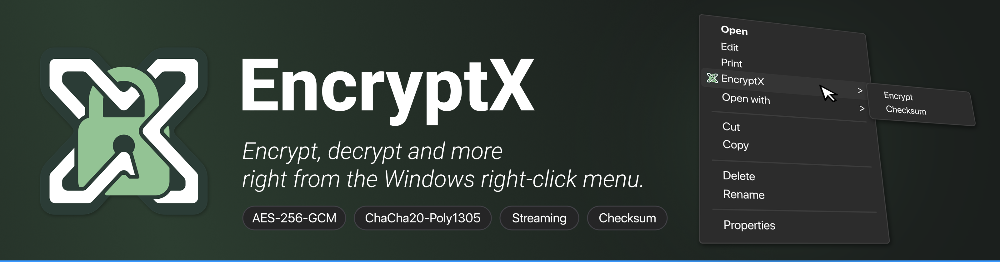
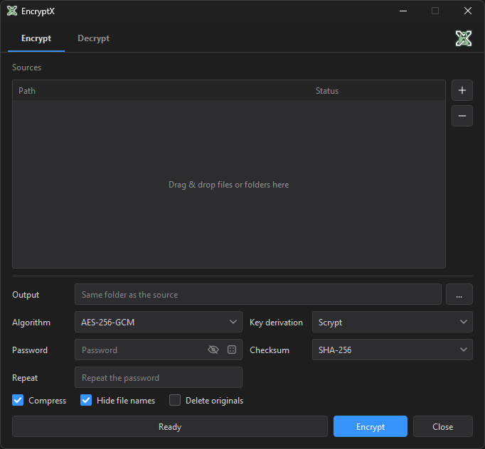
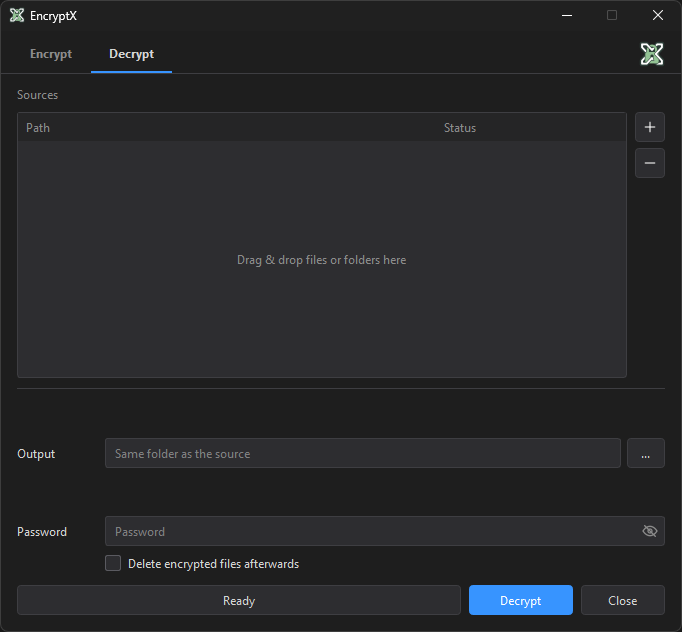
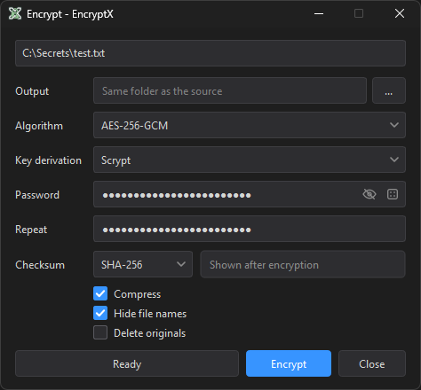
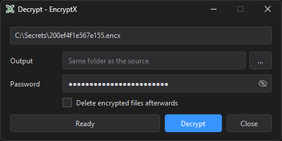
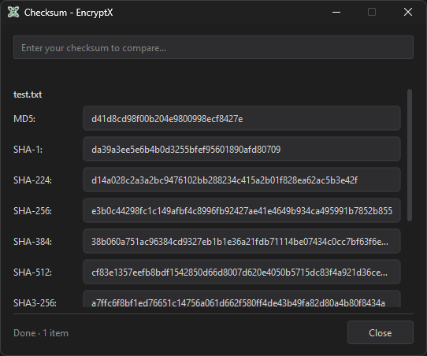

<p align="center">
  
</p>

<p align="center">
  <a href="https://github.com/AbyoAI/EncryptX/actions/workflows/tests.yml"></a>
  
  
  
</p>

**EncryptX** encrypts and decrypts files and folders, and calculates checksums, from the
Windows Explorer right-click menu or from a small drag & drop window.

```
Right-click a file or folder  >  EncryptX  >  Encrypt | Decrypt | Checksum
```

## Features

**Encryption**
- 9 authenticated algorithms: AES-256/192/128-GCM, ChaCha20-Poly1305, AES-256-CCM, AES-256-OCB3,
  and AES-256-CBC / AES-256-CTR / Camellia-256-CBC combined with HMAC-SHA256.
- Password-based keys with **Scrypt** or **PBKDF2-SHA256**.
- **Streaming**: files are processed in 1 MiB chunks, so memory stays around 1 MiB for any file size.
  Folders are streamed as well, with no temporary archive on disk.
- The `.encx` file looks like random data. The original name, the algorithm and all settings are
  encrypted, and there are no magic bytes. Optional random output names ("Hide file names").
- Optional compression (already compressed formats such as `.zip`, `.jpg`, `.mp4` are skipped).
- Optional **end-to-end checksum**: the hash of the original data is stored inside the encrypted
  file and compared again after decryption.
- Optional deletion of the originals after success.

**Checksum**
- 11 algorithms in one pass over the data: MD5, SHA-1, SHA-224, SHA-256, SHA-384, SHA-512,
  SHA3-256, SHA3-512, BLAKE2b, BLAKE2s, CRC32.
- Paste a hash to compare: the matching algorithm turns green, otherwise you see "No match".
  Accepts upper or lower case and whole `sha256sum` lines.
- Works on files and folders. A folder checksum covers names, sizes and contents in a fixed order.

**Interface**
- Classic dark, flat design with a soft fade-in and smooth progress.
- A compact window for each right-click action, and a full window with drag & drop.
- Several selected files open in **one** window.
- Per-user installer (no admin rights) that adds the right-click menu and the `.encx` icon.

## Screenshots

| Full window | Decrypt with checksum verification |
|:---:|:---:|
|  |  |

| Right-click: Encrypt | Right-click: Decrypt | Right-click: Checksum |
|:---:|:---:|:---:|
|  |  |  |

<sub>Screenshots are rendered from the real interface with the Inter font and a drawn window frame.
On Windows the window uses the system title bar and Segoe UI.</sub>

## Requirements

**To use it**
- Windows 10 or 11 (64-bit). Install with the setup file from the
  [Releases](https://github.com/AbyoAI/EncryptX/releases) page.

**To run or build from source**
- Python 3.9 or newer
- [`PySide6-Essentials`](https://pypi.org/project/PySide6-Essentials/) 6.6+ (the Qt interface)
- [`cryptography`](https://pypi.org/project/cryptography/) 42+
- [Inno Setup](https://jrsoftware.org/isdl.php) 6.3+ and `pyinstaller`, only to build the installer
- `pytest`, only to run the tests

The interface also starts on Linux and macOS, but the Explorer menu and installer are Windows only.

## Build from source

```powershell
git clone https://github.com/AbyoAI/EncryptX.git
cd EncryptX

py -m venv .venv
.venv\Scripts\Activate.ps1
python -m pip install --upgrade pip
python -m pip install -r requirements.txt

python run.py                      # start the full window
```

Run the tests (the GUI tests run headless):

```powershell
python -m pip install pytest
pytest
```

Build the program and the installer:

```powershell
build.bat          # PyInstaller -> dist\EncryptX\EncryptX.exe, then Inno Setup -> dist\EncryptX-Setup-2.0.0.exe
```

Run `python -m encryptx` from the `src` folder, never `python src/encryptx/app.py`: the
`encryptx.platform` sub-package would shadow Python's standard `platform` module.

## Usage

**From the right-click menu** (after installing)

| Item | Where it appears | What opens |
|---|---|---|
| EncryptX > Encrypt | any file or folder | compact Encrypt window |
| EncryptX > Decrypt | `.encx` files | compact Decrypt window |
| EncryptX > Checksum | any file or folder | Checksum window, calculating at once |

On Windows 11 the menu is under **Show more options**. Select several files and they all open in the same window.

**Encrypt**
1. Choose the algorithm and key derivation (the defaults are AES-256-GCM and Scrypt).
2. Type a password twice, or open the eye icon to see it, or press the dice icon to generate a strong one.
3. Leave **Checksum** on SHA-256 to verify the files after decryption.
4. Press **Encrypt**. Each file becomes `name.encx` (or a random name) in the output folder, which is
   the source folder when left empty.

**Decrypt**: enter the password and press **Decrypt**. The original name is restored. If a checksum was
stored you will see "SHA-256 verified ✓".

**Checksum**: paste a hash in the box on top (optional). The matching row turns green and scrolls into view.
Click any hash to copy it.

**Full window** (`EncryptX.exe`): drag files or folders into the list, or use **+** and **−**.
Switch between the Encrypt and Decrypt tabs.

**Command line**

```
EncryptX.exe                         full window
EncryptX.exe encrypt  "<path>" ...   compact Encrypt window
EncryptX.exe decrypt  "<file.encx>"  compact Decrypt window
EncryptX.exe checksum "<path>" ...   Checksum window
```

From source use `python run.py` instead of `EncryptX.exe`. `python run.py install-menu` and
`uninstall-menu` register or remove the Explorer menu without the installer (development only).

## Security notes

- **Nothing is custom.** All primitives come from the [`cryptography`](https://cryptography.io) library.
  EncryptX has not had an independent security audit.
- **Your password is the key.** It is stretched with Scrypt (N=2¹⁵, r=8, p=1) or PBKDF2-HMAC-SHA256
  (600,000 iterations) and a random 16-byte salt, then split with HKDF-SHA256 into a header key and a data key.
  A weak password stays weak. Use a long one or the generator. **There is no recovery**: lose the
  password and the data is gone.
- **Tampering is detected.** Data is encrypted in 1 MiB chunks with fresh random nonces. The associated data
  binds each chunk to the file header, its position and a "last chunk" flag, so changed, reordered,
  removed or truncated chunks fail. Decryption writes to a temporary file and deletes it on any error.
- **Metadata is encrypted.** The original name, algorithm, compression flag and checksum are inside the
  encrypted header and trailer (fixed size, so the name length is hidden too).
  **Still visible:** the file size (about the original size plus 1.1 KiB and 28 bytes per MiB), the `.encx`
  extension, timestamps and location. With **Hide file names** off, the output is named `original-name.encx`,
  which reveals the name.
- **Compression leaks a little.** The encrypted size shows how well the data compressed. Turn **Compress** off
  if that matters.
- **The checksum is an extra check, not extra secrecy.** It is stored encrypted and verified after decryption.
  On a mismatch the result is marked as failed and the encrypted file is kept. Folder checksums use
  EncryptX's own format and will not match other tools. File checksums are the standard hashes.
- **Comparing hashes.** MD5, SHA-1 and CRC32 detect accidental damage only; they are not collision resistant.
  A match only proves anything if the reference hash came from a source you trust. Prefer SHA-256 or stronger.
- **Deleting originals is not a secure wipe.** "Delete originals" removes the files normally. Copies can remain
  in backups, shadow copies or on SSD cells. Test that you can decrypt before you delete, and keep backups.
- **Out of scope.** The password stays in memory while a window is open and cannot be reliably wiped.
  Encryption does not protect against malware, keyloggers, or anyone who can reach the unlocked files.
- **Folders.** Symbolic links are skipped, owner names are not stored, and extraction rejects any path that
  would leave the destination folder.
- **Compatibility.** Files made by EncryptX 1.x use an older format and cannot be opened by 2.x.

Found a vulnerability? Please report it privately through **Security > Report a vulnerability** on the
GitHub repository instead of opening a public issue.

## Project layout

```
src/encryptx/
    app.py                          entry point / command line
    crypto/modern.py                streaming authenticated encryption
    core/file_operations.py         encrypt, decrypt, checksum (no GUI)
    gui/styles.py                   dark flat theme and icons
    gui/widgets.py                  buttons, source list, progress bar, hash boxes
    gui/forms.py                    Encrypt / Decrypt option panels
    gui/jobs.py                     background thread and shared run controller
    gui/main_window.py              the full window
    gui/dialogs.py                  the compact right-click windows
    platform/windows_context_menu.py    Explorer menu (development helper)
    platform/single_instance.py         many selected files -> one window
assets/                             logo and .encx file icon
docs/                               banner and screenshots
installer/EncryptX.iss              Inno Setup script (installs and writes the registry keys)
tests/                              pytest (core and headless GUI tests)
```

## License

GNU Affero General Public License v3.0 or later. See [LICENSE](LICENSE).
